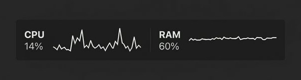
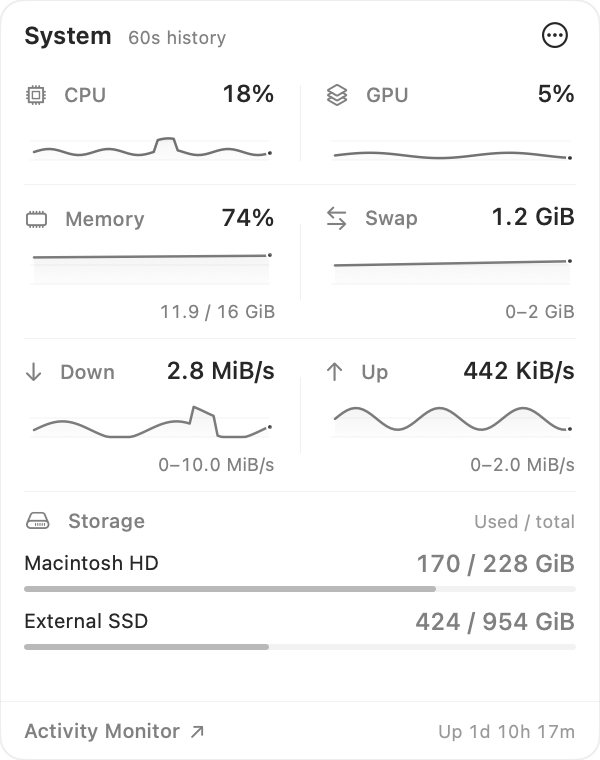

#  SysMonitor

**[View Landing Page](https://ch2ohch2oh.github.io/sysmonitor)**

<div align="center">
  
  <br /><br />
  
  <p><sub>Details preview with sample data.</sub></p>
</div>

SysMonitor is a lightweight, menu-bar system resource monitor for macOS. It provides real-time updates for:

- **CPU Usage**: Real-time percentage.
- **RAM Usage**: Real-time percentage and Used/Total GB.
- **Disk Usage**: Used/Total GB.
- **GPU Usage**: Utilization when supported by your Mac.
- **Network**: Wi-Fi and Ethernet download/upload rates.
- **Memory Pressure**: Normal, elevated, or high when available.

Requires **macOS 13 or later**. Release packaging produces a universal Apple silicon/Intel app by default.

## Installation

1. **Unzip the App**: Double-click `SysMonitor.zip` to extract `SysMonitor.app`.
2. **Move to Applications**: Drag `SysMonitor.app` into your `Applications` folder.
3. **Launch**: Double-click the app to start it. It will appear in your menu bar.

## Troubleshooting

### "Unverified Developer" Warning

Unsigned builds may be blocked by macOS. After attempting to launch a build you trust, use **System Settings → Privacy & Security → Open Anyway**, if offered. Public releases should be Developer ID signed and notarized; the packaging script supports both.

## Usage

- **Click** the menu bar item (e.g., `CPU: 12% RAM: 45%`) to see detailed stats.
- **Right-click** the menu bar item to access the **About** and **Quit** options.
- The popup's **… menu** also exposes Settings, About, and Quit. Press **Escape** or click outside to dismiss it.
- Select **Activity Monitor** to investigate resource use.
- Charts show the **last 60 seconds**; gaps represent missing samples. Network charts display their current scale.
- Readings distinguish sampling, unavailable counters, and read failures. If updates stop for more than five seconds, the popup marks its readings as stale.
- CPU is averaged across all cores. RAM is an estimate of active, wired, and compressed memory, in GiB; high usage alone does not imply high memory pressure.
- Network counts physical Wi-Fi/Ethernet interfaces, excluding VPN and bridge counters to avoid double counting. Rates use binary units (KiB/s, MiB/s).
- Disk readings include writable local volumes and refresh every 15 seconds.

## Development

```sh
swift build
swift test
```

The tests cover counter rollover, interface changes, history gaps, stale readings, overlapping fetches, and popup placement. CI runs them on pull requests and before release packaging.

For a local native debug bundle:

```sh
CONFIGURATION=debug ARCHITECTURES=native ./package.sh
open SysMonitor.app
```

## Distribution

```sh
VERSION=1.0.0 BUILD_NUMBER=1 ./package.sh
```

This builds both architectures. To sign and notarize, first install your Developer ID Application certificate and store notarization credentials with `xcrun notarytool store-credentials`. Then run:

```sh
SIGNING_IDENTITY="Developer ID Application: Your Name (TEAMID)" \
NOTARY_PROFILE="your-notary-profile" \
VERSION=1.0.0 BUILD_NUMBER=1 ./package.sh
```

The script signs with hardened runtime, waits for notarization, staples the ticket, and validates the bundle. Without signing credentials it creates a local unsigned bundle. The release workflow does not currently install signing credentials; configure these before distributing a trusted public release.

## Uninstall

To remove SysMonitor from your system:

1. **Quit the App**: Click the SysMonitor icon in the menu bar and select **Quit SysMonitor**.
2. **Delete the App**: Drag `SysMonitor.app` from your `Applications` folder to the Trash.
